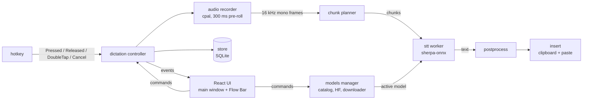

# FlowLocal

[](https://github.com/Lets-Decode-AI/FlowLocal/actions/workflows/ci.yml)
[](LICENSE)
[](https://github.com/Lets-Decode-AI/FlowLocal/releases/latest)

**Private, push-to-talk dictation that runs entirely on your computer.**

Hold a hotkey in any app, speak, release, and punctuated text appears at your cursor. FlowLocal is a
lightweight, open-source take on tools like Wispr Flow, with one key difference: speech recognition
runs **locally** using [sherpa-onnx](https://github.com/k2-fsa/sherpa-onnx) models such as NVIDIA
Parakeet. Your audio never leaves your machine, and there is no account or subscription.

It is a small [Tauri 2](https://tauri.app) app (Rust core, React UI) that lives in the system tray.
Everything it needs, including the ONNX Runtime libraries, ships inside the installer. Models are
downloaded from Hugging Face from within the app.

> Status: Part 1 (core dictation and the local model manager) is implemented. See the [Roadmap](#roadmap).

## Features

- Push-to-talk and hands-free dictation into any focused text field (double-tap the hotkey for hands-free, `Esc` to cancel).
- Local speech-to-text with sherpa-onnx; no network is used for transcription.
- In-app model manager: a curated catalog, Hugging Face search, one-click download with resume, SHA-256 verification, pause/resume/cancel, and per-model disk usage.
- A hardware-aware default model is recommended on first run.
- Streaming chunked transcription, so long dictations finish quickly after you let go of the key.
- Flow Bar: a small always-on-top pill that shows recording, transcribing, done and error states without taking focus.
- Text is inserted by pasting, and your clipboard (text or image) is restored afterwards. Only plain text and images are
  restored: rich formatting (HTML/RTF) comes back as plain text, and if the clipboard held something FlowLocal cannot read
  (files, for example) it is left alone rather than cleared.
- Personal dictionary replacements, simple capitalization and spacing clean-up.
- Searchable local history of your dictations (SQLite on your machine).
- Low resource use: tray-only at rest, and the model is unloaded after an idle timeout (default 10 minutes, configurable, or never).
- Optional Hugging Face token for gated or private repos, stored in the OS keychain.
- Launch at login, microphone selection, rebindable hotkeys.

## Privacy

- Audio is processed on your device and is never uploaded; there is no account and no telemetry.
- The microphone stays open for up to 15 s after a dictation so the next one doesn't clip the first word. While it is open only the latest 0.3 s of audio is held in memory,
  and it is closed after that.
- The only network traffic is downloading models (and searching) on Hugging Face, which you start yourself.
- Custom Hugging Face repos: files tracked with Git LFS are verified against their SHA-256; non-LFS files
  (such as `tokens.txt`) are only size-checked because Hugging Face publishes no hash for them.

## Screenshots

_Screenshots will be added here. Contributions welcome._

<!-- Add images under docs/images/ and reference them here. -->

## Install

Download the installer for your system from the
[Releases page](https://github.com/Lets-Decode-AI/FlowLocal/releases/latest).

| OS | File | Notes |
|---|---|---|
| macOS (Apple Silicon) | `FlowLocal_<version>_aarch64.dmg` | |
| macOS (Intel) | `FlowLocal_<version>_x64.dmg` | |
| Windows (x64) | `FlowLocal_<version>_x64-setup.exe` | NSIS installer |
| Linux (x64) | `.AppImage` or `.deb` | |

Models are not bundled. On first launch the onboarding flow downloads a recommended model
(Parakeet TDT 0.6B v2, about 660 MB, by default).

### macOS

Release builds may be **unsigned** (they are signed and notarized only if the maintainers have
configured signing certificates). If macOS says the app "is damaged" or "cannot be opened because
the developer cannot be verified":

1. Drag FlowLocal to `/Applications`.
2. Try to open it once, then go to System Settings > Privacy & Security, scroll to the Security section and click **Open Anyway** (macOS 15 and later); or
3. run `xattr -dr com.apple.quarantine /Applications/FlowLocal.app` in Terminal.

FlowLocal needs two permissions, which onboarding walks you through (System Settings > Privacy & Security):

- **Microphone** - to record your voice.
- **Accessibility** - for the global hotkey (the `Fn` key is read through an event tap) and to send the paste keystroke.
  If it has not been granted yet, FlowLocal shows "Grant Accessibility to enable the hotkey"; the hotkey starts as soon as
  you grant it (no relaunch needed).

If you use the `Fn` / Globe key as the hotkey, set System Settings > Keyboard > "Press 🌐 key to:" **Do Nothing**,
otherwise macOS may open the emoji picker or its own dictation at the same time.

### Windows

Run the installer. Windows SmartScreen may warn about an unrecognized publisher for unsigned builds
(More info > Run anyway). The default hotkey is hold `Ctrl+Win`.

### Linux

- **X11**: fully supported. Default hotkey is hold `Ctrl+Super`.
- **Wayland**: the global hotkey is currently unavailable (the app shows a "Global hotkey unavailable on Wayland"
  notice); use an X11 session for now. Where synthetic paste is blocked, the text is left on the clipboard and you paste it yourself.
  Hotkey support via the XDG GlobalShortcuts portal is on the [Roadmap](#roadmap).
- Make the AppImage executable (`chmod +x FlowLocal_*.AppImage`) or install the `.deb` with `sudo apt install ./FlowLocal_*.deb`.

## Supported models

The catalog is bundled in the app ([`src-tauri/resources/catalog.json`](src-tauri/resources/catalog.json)),
with sizes and SHA-256 hashes pinned to specific Hugging Face revisions. You can also search Hugging Face
from the app for other sherpa-onnx repos; compatible transducer, Whisper, Moonshine and SenseVoice layouts are detected automatically.

| Model | Engine | Download | Languages | Min RAM |
|---|---|---|---|---|
| Parakeet TDT 0.6B v2 (int8), **default** | Transducer | ~661 MB | English | 4 GB |
| Parakeet TDT 0.6B v3 (int8) | Transducer | ~670 MB | 25 European languages | 4 GB |
| Moonshine Base (int8) | Moonshine | ~286 MB | English | 2 GB |
| Whisper tiny.en (int8) | Whisper | ~103 MB | English | 2 GB |
| Whisper small.en (int8) | Whisper | ~375 MB | English | 3 GB |
| SenseVoice small (int8) | SenseVoice | ~239 MB | Chinese, English, Japanese, Korean, Cantonese | 2 GB |
| Whisper large-v3-turbo (int8) | Whisper | ~1 GB | Multilingual (35 languages listed in the catalog) | 6 GB |

On first run FlowLocal recommends Moonshine Base on low-RAM machines, Parakeet v3 or SenseVoice for matching
system locales, and Parakeet v2 otherwise.

### Measured performance

From the project's integration test (Parakeet v2 int8, release build, on an Apple Silicon Mac; your hardware will differ):

- Clips of 4-6 s transcribe in roughly 360-530 ms (best run: a 5 s clip in about 362 ms).
- A 62.5 s streamed dictation finishes about 421 ms after key-up.
- Word error rate of 0.0 on the project's synthetic text-to-speech fixture set (a small set, not a general accuracy benchmark).

## How streaming chunked transcription works

Transcribing a long recording in one go would make you wait after you release the key. Instead, while you are
still speaking, a pure **chunk planner** watches the live 16 kHz audio and cuts it at natural pauses:

- once a chunk is at least 4 s long, it is cut at the first pause of 300 ms or more;
- if a chunk reaches 15 s without a pause, it is cut at the quietest 20 ms frame in the last 3 s;
- completed chunks are queued to a single STT worker thread and transcribed **in order** in the background;
- silent chunks are skipped.

When you release the key only the short final chunk is left, so the time after key-up depends on that one chunk and
not on how long you talked. Chunk texts are joined in order, then post-processed and pasted.

## Architecture



A single Rust process owns audio, inference, hotkeys, I/O and persistence; the web UI only renders. Module map
(all under [`src-tauri/src`](src-tauri/src)):

| Module | Responsibility |
|---|---|
| `hotkey` | Global triggers (macOS `Fn` event tap, `rdev`, Wayland portal stub) and the tap / double-tap gesture logic |
| `audio` | `cpal` capture, resampling to 16 kHz mono, energy VAD, level meter |
| `dictation` | Pure state machine plus the controller that wires audio, STT, post-processing, insertion and storage |
| `stt` | `ChunkPlanner`, `SttSession`, the worker thread and the sherpa-onnx engine |
| `models` | Catalog, Hugging Face search, resumable verified downloader, hardware detection, lifecycle |
| `postprocess` | Spacing and capitalization fixes, dictionary replacements |
| `insert` | Clipboard save/restore, synthetic paste, frontmost-app lookup |
| `store` | SQLite: transcripts, settings, dictionary, downloads, migrations |
| `permissions` | Per-OS permission checks and deep links |
| `commands`, `events`, `tray`, `app_state` | Tauri command layer, event names, tray menu, shared state |

The React/TypeScript UI is in [`src`](src) (`flowbar.html` is the Flow Bar window).

## Build from source

Prerequisites: [Rust](https://rustup.rs) (the toolchain is pinned to 1.99.1 by `rust-toolchain.toml`; Rust 1.88 or newer is required), Node.js 20 or newer,
and the platform dependencies for [Tauri 2](https://tauri.app/start/prerequisites/). On Ubuntu:

```bash
sudo apt-get install -y libwebkit2gtk-4.1-dev libayatana-appindicator3-dev librsvg2-dev libasound2-dev libxdo-dev libxtst-dev libxi-dev cmake clang
```

```bash
git clone https://github.com/Lets-Decode-AI/FlowLocal.git
cd FlowLocal
npm ci
npm run tauri dev      # run the app with hot reload
npm run tauri build    # produce an installer for your OS in src-tauri/target/release/bundle
```

The first build downloads prebuilt sherpa-onnx binaries and compiles a lot of Rust, so it takes a while.
On macOS, grant Microphone and Accessibility to the terminal or app you launch it from when testing hotkeys.

## Running tests

```bash
# Rust unit tests
cd src-tauri && cargo test

# Lint and formatting (also run in CI)
cargo fmt --check
cargo clippy --all-targets -- -D warnings

# Frontend
cd .. && npx tsc --noEmit && npx vitest run
```

The real-model integration tests (WER on fixtures, streaming latency) are `#[ignore]`d because they need a
~660 MB model. To run them:

```bash
scripts/fetch_test_model.sh          # downloads Parakeet v2 int8 to ~/Library/Caches/FlowLocal Test é/parakeet-v2
cd src-tauri
FLOWLOCAL_MODEL_DIR="$HOME/Library/Caches/FlowLocal Test é/parakeet-v2" \
  cargo test --release --test stt_integration -- --ignored --nocapture
```

On Linux pass a destination directory to the script and use the same path for `FLOWLOCAL_MODEL_DIR`.
The manual end-to-end checks for dictation in real apps are listed in [docs/E2E-CHECKLIST.md](docs/E2E-CHECKLIST.md).

## Roadmap

- **Linux/Wayland**: global hotkeys through the XDG GlobalShortcuts portal.
- **Part 2 - text intelligence**: local LLM cleanup (llama.cpp), optional bring-your-own API key (OpenAI / Anthropic),
  Command Mode, snippets and per-app styles.
- **Part 3 - dashboard**: a Wispr-style analytics dashboard (words, WPM, streaks, time saved), full history, and polished settings and onboarding.

Not planned for Part 1: auto-update, accounts or sync. Release process: [docs/RELEASING.md](docs/RELEASING.md).

## Contributing

Contributions are welcome. Please read [CONTRIBUTING.md](CONTRIBUTING.md) and the
[Code of Conduct](CODE_OF_CONDUCT.md). Report security issues privately as described in [SECURITY.md](SECURITY.md);
questions go through [SUPPORT.md](SUPPORT.md).

## License

[MIT](LICENSE) (c) 2026 Lets Decode AI.

## Acknowledgements

- [sherpa-onnx](https://github.com/k2-fsa/sherpa-onnx) (k2-fsa) and the [`sherpa-rs`](https://github.com/thewh1teagle/sherpa-rs) bindings, plus [csukuangfj](https://huggingface.co/csukuangfj) for the converted model repos.
- [NVIDIA NeMo Parakeet](https://huggingface.co/nvidia/parakeet-tdt-0.6b-v2) speech models.
- [OpenAI Whisper](https://github.com/openai/whisper), [Moonshine](https://github.com/moonshine-ai/moonshine) and [SenseVoice](https://github.com/FunAudioLLM/SenseVoice) models.
- [Tauri](https://tauri.app) for the app framework.
- Inspired by [Wispr Flow](https://wisprflow.ai). FlowLocal is an independent project and is not affiliated with Wispr.

Model weights are downloaded from their upstream repositories and remain under their own licenses.
